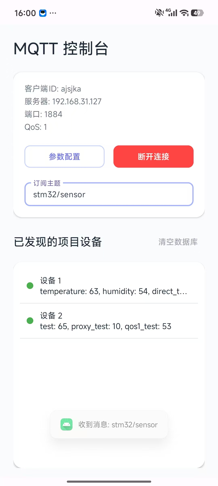
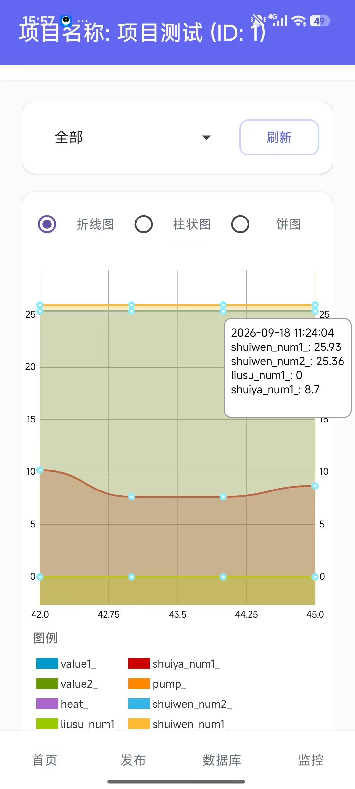
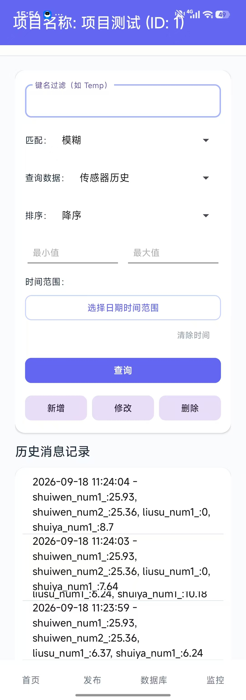

# chapter05 — 纯 Java 的 MQTT 物联网控制台

> 物联网创新设计竞赛（IoT Innovation Design Competition）参赛作品

一个基于 **Java + MQTT** 的 Android 物联网设备监控与控制台。接收设备上报的 JSON 数据，自动识别并拆分为「普通设备」与「特殊设备」，提供传感器实时值、历史曲线、开关控制、阈值告警、定时任务、主题切换、组合查询等完整功能。（UniApp + Node.js + MySQL 智能检测平台），但通信层只依赖本地 MQTT（默认端口 `1883`端口可更改），不绑定任何云平台 SDK。

> 本项目是 `mizai` 多模块 Android 工程中的一个模块，单独开源时需连同 `date_time_picker` 子模块一起导出。

---

## 目录

- [核心特性](#核心特性)
- [功能演示](#功能演示)
- [设备识别与 JSON 解析机制](#设备识别与-json-解析机制)
- [功能模块](#功能模块)
- [技术栈](#技术栈)
- [目录结构](#目录结构)
- [构建与运行](#构建与运行)
- [快速上手](#快速上手)
- [配置说明](#配置说明)
- [已知问题与注意事项](#已知问题与注意事项)

---

## 核心特性

- **MQTT 收发 + 设备列表**：连接、订阅、发布，设备列表自动生成，支持置顶；10 秒内收到过消息即判为在线（绿/红指示灯）。
- **特殊 / 普通设备自动分类**：根据 JSON 键名结构自动区分多设备与特殊设备（见下文机制）。
- **传感器实时值 + 历史图表**：首页折线 / 柱状 / 饼图三种视图切换，实时 JSON 卡片显示带数字后缀的**原始 JSON**。
- **传感器别名（改名）**：长按实时数据列表可给传感器改显示名，下拉列表、图例、tooltip 全部跟随别名。
- **发布消息**：MQTT / HTTP 双通道切换，HTTP 上报支持「从历史数据自动填充」。
- **开关控制 + 自动开关**：开关带 `publishTopic` 与响应规则字段；自动 / 手动模式按钮，键值匹配自动切模式；开关指令发出后本地立即回显状态。
- **阈值告警**：上下限 + 阈值下发 + 报警 JSON 指令 + 全局报警通知卡片。
- **定时任务**：倒计时 N 秒后把 `keyName` 置为 `targetState`（开/关）并发布到指定主题。
- **主题控制**：normal / warning / danger / info / offline 五色主题，HTTP / MQTT 键值触发切换。
- **组合数据查询**：按表类型（传感器历史 / 报警记录 / MQTT 消息 / 上报记录）+ 关键词模糊/精确 + 双向模糊匹配 + 排序 + 时间范围 + 数值范围查询。
- **响应规则引擎**：`getByPath` 点路径取值（支持 `[n]`、`*`、`**`）+ `matchValue` 开关量归一化，HTTP 响应与 MQTT 上行都会触发开关 / 主题 / 定时 / 阈值四类规则。

---

## 功能演示

真机运行截图共 17 张，覆盖连接配置、设备发现、三种图表、发布 / 查询 / 监控与四个管理页，完整说明见 [docs/screenshots](./docs/screenshots/README.md)。

| 设备自动发现 | 折线图实时曲线 | 组合数据查询 |
| --- | --- | --- |
|  |  |  |

---

## 设备识别与 JSON 解析机制

这是本项目的核心：**同一条 MQTT 上行数据，会根据 JSON 键名结构拆成不同设备**。判断逻辑在 `ProjectDataManager.updateFromJson()` 与 `SpecialJsonIdentifier.isSpecialJson()`。

### 普通设备（多设备 JSON）

**特征**：JSON 的**所有键名都以数字结尾**（`\d+$` 匹配），且至少存在一个数字后缀。

```json
{"Temp1": "25.5", "Humi1": "60", "Temp2": "26.1", "Humi2": "55"}
```

- 以键名**末尾数字作为设备 ID**（`extractProjectId`），按 ID 分组拆成多个设备。
- 传感器名 = 键名去掉末尾数字（`extractSensorName`，用 `replaceAll("\\d+$", "")`），如 `Temp1` → `Temp`。
- 设备显示名形如 `设备 1`、`设备 2`。

### 特殊设备（非多设备 JSON）

**特征**：JSON 中**并非所有键名都以数字结尾**，例如：

```json
{"Soil_Water": "35", "CO2": "800", "Mode": "auto"}
```

- 将键名**排序后逗号拼接作为 schema**（如 `CO2,Mode,Soil_Water`）做去重匹配，相同键集合复用同一设备。
- 新设备 ID 从 `10000` 递增（`SPECIAL_PROJECT_THRESHOLD`），显示名形如 `特殊设备 10000`，列表文字用**橙色**区分。
- 特殊 JSON 额外存入专用数据库 `special_json_data.db`；数字型传感器值才写入传感器历史（用于图表）。

| 类型 | 判定条件 | 拆分方式 | 设备 ID | 列表显示 |
| --- | --- | --- | --- | --- |
| 普通设备 | 所有键以数字结尾 | 按末尾数字分组 | 键名后缀 | `设备 N`（默认色） |
| 特殊设备 | 存在非数字结尾的键 | 按键集合 schema 去重 | 10000 起递增 | `特殊设备 N`（橙色） |

---

## 功能模块

### 主页面（MainActivity）
- MQTT 配置（客户端 ID / 服务器 / 端口 / QoS）、连接与订阅主题。
- 设备列表：置顶、改名、删除、在线状态、清空数据库。

### 设备详情页（ProjectDetailActivity）
底部四个 Tab：

1. **首页（DetailHomeFragment）**：实时传感器数据卡片、折线 / 柱状 / 饼图切换、传感器别名（长按改名）。
2. **发布（DetailPublishFragment）**：MQTT / HTTP 双通道发布、开关控制、从历史数据填充。
3. **数据库（DetailDatabaseFragment）**：组合数据查询（四种表类型 + 多条件筛选）。
4. **监控（DetailMonitorFragment）**：设备监控视图。

### 4 个独立管理页面
| 页面 | 类 | 功能 |
| --- | --- | --- |
| 开关管理 | `SwitchManagerActivity` | 开关 CRUD，字段含 `displayName / jsonKey / publishTopic / activeHigh` + 响应规则 |
| 阈值管理 | `ThresholdManagerActivity` | 上下限、阈值下发、报警 JSON 指令 |
| 定时管理 | `ScheduleManagerActivity` | 倒计时定时任务 |
| 主题管理 | `ThemeManagerActivity` | 五色主题 + HTTP/MQTT 键值触发 |

---

## 技术栈

| 类别 | 技术 |
| --- | --- |
| 语言 | 纯 Java（`date_time_picker` 子模块用 Kotlin） |
| MQTT | Eclipse Paho `1.2.5` + `paho.android.service 1.1.1` |
| 图表 | MPAndroidChart `v3.1.0`（LineChart / BarChart / PieChart） |
| JSON | Gson `2.10.1` + `org.json` |
| HTTP | 原生 `HttpURLConnection`（`HttpManager.java`，无 OkHttp） |
| 存储 | SQLite（多库）+ SharedPreferences + Gson |
| 日期时间选择 | 本地模块 `date_time_picker`（loper7 DateTimePicker） |
| 最低版本 | minSdk 24 / targetSdk 36 / compileSdk 36 |

### SQLite 数据库划分
| 数据库文件 | 用途 |
| --- | --- |
| `projects.db` | 项目 |
| `mqtt_messages.db` | MQTT 消息 |
| `sensor_history.db` | 传感器历史 |
| `special_json_data.db` | 特殊 JSON 原始数据 |
| `alarm_history.db` | 报警记录 |
| `publish_history.db` | 上报记录 |

### SharedPreferences 配置项
`switch_config`（开关）、`threshold_config`（阈值）、`schedule_config`（定时）、`theme_config`（主题）、`auto_switch_config`（自动开关）、`sensor_alias`（传感器别名）、`detail_publish`（发布主题）、`config_mqtt`（MQTT 配置）。

---

## 目录结构

```
chapter05/
├── build.gradle                     # 模块构建脚本
├── proguard-rules.pro
├── date_time_picker/                # 本地日期时间滚轮选择器子模块（Kotlin）
├── libs/                            # 本地 jar/aar 依赖
└── src/main/
    ├── AndroidManifest.xml
    ├── java/com/example/chapter05/
    │   ├── MainActivity.java                    # 主页面：MQTT 配置 + 设备列表
    │   ├── ProjectDetailActivity.java           # 设备详情页（四 Tab）
    │   ├── DetailHomeFragment.java              # 首页：实时值 + 图表
    │   ├── DetailPublishFragment.java           # 发布：MQTT/HTTP + 开关
    │   ├── DetailDatabaseFragment.java          # 数据库：组合查询
    │   ├── DetailMonitorFragment.java           # 监控
    │   ├── MqttManager.java                     # MQTT 收发核心（单例）
    │   ├── ProjectDataManager.java              # JSON 解析 + 设备分类（单例）
    │   ├── SpecialJsonIdentifier.java           # 特殊 JSON 识别
    │   ├── ResponseRuleEngine.java              # 响应规则引擎
    │   ├── ScheduleManager.java                 # 定时任务（单例）
    │   ├── AlarmCenter.java                     # 全局报警通知（单例）
    │   ├── SensorAliasHelper.java               # 传感器别名
    │   ├── HttpManager.java                     # 原生 HTTP 请求
    │   ├── SwitchManager.java / SwitchItem.java # 开关
    │   ├── ThresholdManager.java / ThresholdItem.java   # 阈值
    │   ├── ScheduleManagerActivity.java / ...   # 各管理页
    │   ├── ThemeManager.java / ThemeItem.java   # 主题
    │   ├── AutoSwitchManager.java               # 自动开关
    │   ├── SensorChartManager.java              # 折线图
    │   ├── BarChartManager.java                 # 柱状图
    │   ├── PieChartManager.java                 # 饼图
    │   ├── Project.java / Item.java / Sensor.java ...
    │   └── *DatabaseHelper.java                 # 各 SQLite 帮助类
    └── res/
        ├── layout/                              # 布局文件
        ├── values/                              # strings/colors/themes
        └── mipmap-*/                            # 图标
```

---

## 构建与运行

### 环境要求
- Android Studio（推荐最新版）
- JDK 17（本机若只有 JDK17，需注意 toolchain 配置，见下方「已知问题」）
- Android SDK（compileSdk 36）

### 方式一：Android Studio
1. 用 Android Studio 打开父工程 `mizai`（或仅 chapter05 相关模块）。
2. 同步 Gradle 后选择 `chapter05` 模块运行。

### 方式二：命令行
```bash
# 编译安装到设备
./gradlew :chapter05:installDebug

# 单独打 debug 包
./gradlew :chapter05:assembleDebug
```

> **注意**：`chapter05` 依赖本地模块 `implementation project(':chapter05:date_time_picker')`，开源导出时请一并保留该目录，否则编译会报找不到模块。

---

## 快速上手

1. **连接 MQTT**：主页点击「MQTT 配置」填入 broker 地址（默认可试公共 broker `broker.hivemq.com:1883`），输入订阅主题后点击「连接并订阅」。
2. **接收数据**：设备上报 JSON 后，列表自动生成「设备 N」或「特殊设备 N」。
3. **查看数据**：点击设备进入详情页，首页看实时值与曲线，长按传感器改名。
4. **下发指令**：「发布」页选择 MQTT / HTTP 通道，或用「开关 / 阈值 / 定时 / 主题」四个管理页配置并触发。

---

## 配置说明

- **MQTT 配置**：客户端 ID / 服务器地址 / 端口 / QoS，存储于 `config_mqtt`。
- **开关字段**：`displayName`、`jsonKey`（完整键名，不 strip 后缀）、`publishTopic`、`activeHigh`，以及响应规则 `respArrayPath / respTargetKey / respCommandKey / respValueMap`。
- **响应规则值归一化**：`on / 1 / true / open / 开` 归一化为 `1`，`off / 0 / false / close / 关` 归一化为 `0`，支持 `respValueMap` 自定义映射。

---

## 已知问题与注意事项

1. **toolchain 21 与 JDK17 冲突**：工程 `gradle-daemon-jvm.properties` 配置了 toolchain 21，本机只有 JDK17 时命令行编译需临时移除该文件改用 JDK17，编译完恢复；Android Studio 构建无此问题。
2. **小米 / Android 16 收不到系统广播**：`sendBroadcast` 在小米上可能收不到，UI 实时刷新建议改用 `MqttManager.MessageListener` 回调（如 `onSwitchStateChanged`），本项目已改为此方案。
3. **阈值 / 开关匹配用完整键名**：键名末尾数字（如 `c66-1-1`、`value1_1`）是设备编号的一部分，匹配时**不要** strip 后缀。
4. **查询双向模糊匹配**：传感器历史存的 sensor_name 已 strip 后缀，用户输入带后缀完整键名时需「数据包含关键词 || 关键词包含数据」双向 contains 才能命中。
5. **清空数据库要同步清 SharedPreferences**：`clearAllDatabases()` 中必须同时清各 Manager 的 `clearAll()` 和 `sensor_alias`。
6. **Manager 的 getter 每次返回新 List**：更新状态后要用 `adapter.updateData(新List)` 替换，不能只 `notifyDataSetChanged()`。

---

## 参考

- 日期时间选择器来自 [loper7 DateTimePicker](https://github.com/loper7/DateTimePicker)。
