# 功能演示

以下截图均来自真机运行（Android，`minSdk 24`）。MQTT 服务端为局域网自建 Broker
（`192.168.10.200:1883`），设备端按 `stm32/sensor` 主题上报 JSON。

设备端上报的原始载荷如下，后续所有设备列表、图表均由此解析而来：

```json
{
  "temperature1": 63, "humidity1": 54, "battery1": 42, "direct_test1": 10,
  "proxy_test2": 10, "qos1_test2": 53, "test2": 65
}
```

所有键名都以数字结尾，属于「普通设备（多设备 JSON）」：以键名末尾数字分组，拆成
两台设备；显示时再去掉末尾数字（`temperature1` → `temperature`）。

---

## 一、连接与设备发现

| 参数配置 | 未连接状态 |
| --- | --- |
| 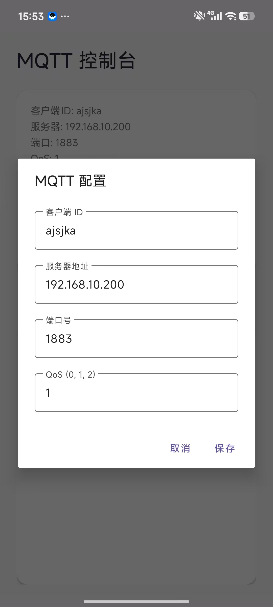 | 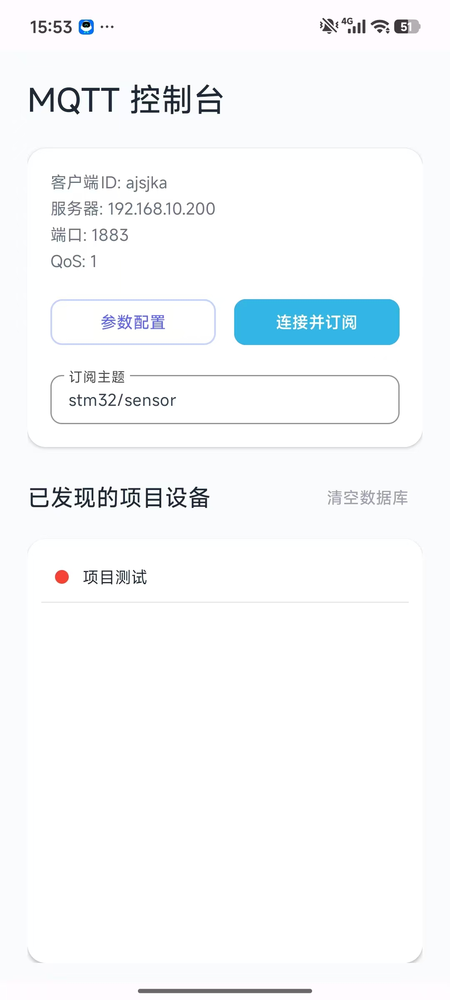 |
| 客户端 ID、服务器地址、端口、QoS（0/1/2）四项均可改，保存后写入 `config_mqtt` | 未连接时按钮为「连接并订阅」，设备列表为空 |

连接成功后，设备列表按末尾数字自动生成。**红点表示 10 秒内未收到该设备消息**，
收到消息转绿：

| 设备离线（红点） | 收到消息后在线（绿点） |
| --- | --- |
| 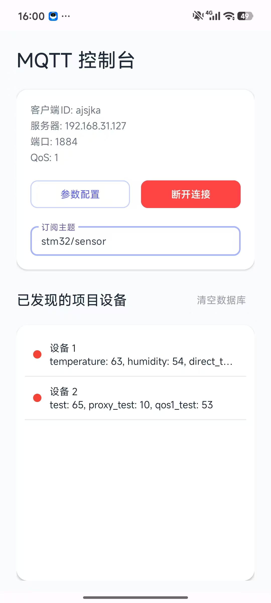 |  |
| 订阅已建立，但尚未收到设备数据 | 底部提示「收到消息: stm32/sensor」，两设备同时转绿 |

长按设备条目可修改名称、删除项目或置顶：

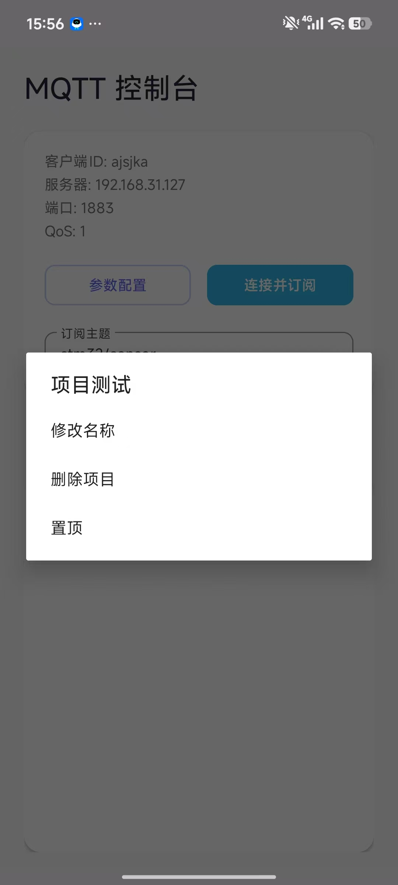

---

## 二、设备详情：三种图表与筛选

进入设备详情后，首页支持折线图、柱状图、饼图三种视图切换，图例与 tooltip 会跟随
传感器别名变化。

| 折线图 | 柱状图 |
| --- | --- |
|  | 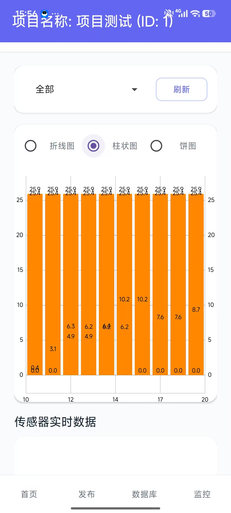 |
| tooltip 同时显示时间戳与各传感器数值 | 便于横向比较同一时刻的多路读数 |

| 饼图 | 传感器筛选 |
| --- | --- |
| 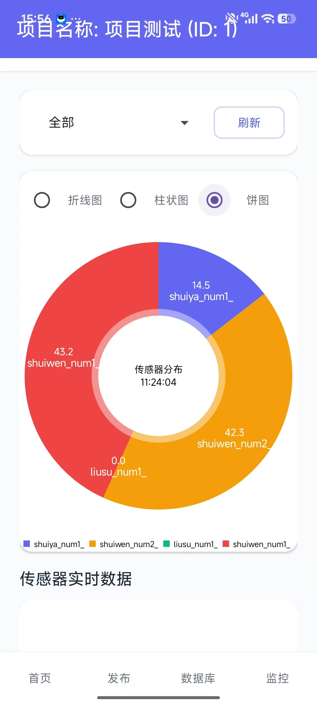 | 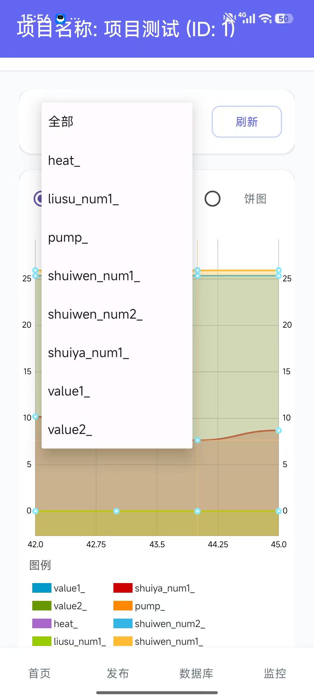 |
| 环形图中心显示「传感器分布 + 时刻」，外环为各传感器占比 | 下拉可在「全部」与单个传感器之间切换，仅保留所选曲线 |

---

## 三、发布、查询与监控

**发布页**顶部四个入口对应开关、阈值、定时、主题四类指令，通道可在 MQTT 与 HTTP
之间切换；「从历史数据自动填充」会把最近一次上行数据填入消息体，便于改值后回发。
下方的模式切换用于手动 / 自动控制。

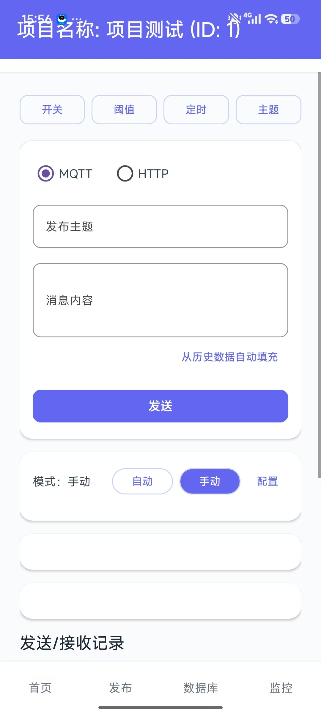

**数据库页**提供组合查询：键名过滤 + 模糊/精确匹配 + 数据源选择（传感器历史、报警
记录、MQTT 消息、上报记录）+ 升降序 + 数值区间 + 时间范围，结果按时间倒序展示，
并支持对记录做增、改、删。


**监控页**通过输入网址在应用内嵌页面中加载监控画面（截图以普通网页演示加载能力，
实际可替换为摄像头出流页面或 YOLOv8 检测服务地址）。


---

## 四、四个管理页

| 开关管理 | 阈值管理 |
| --- | --- |
| 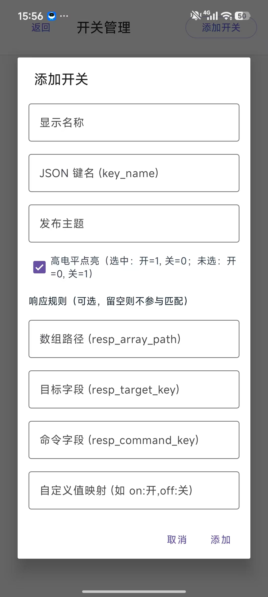 | 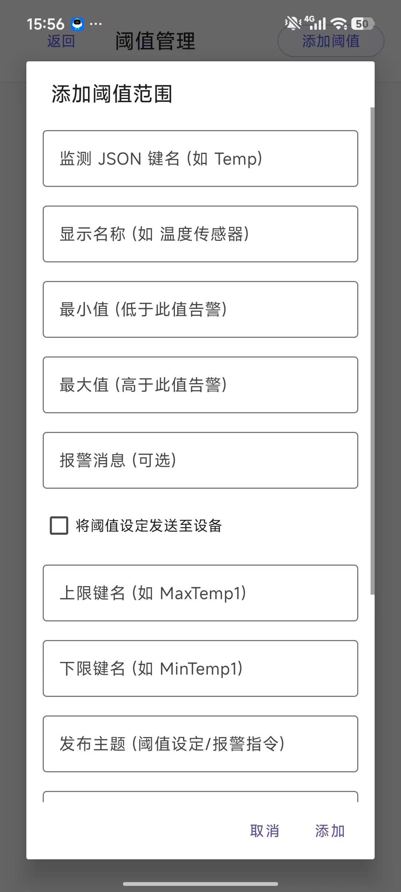 |
| 显示名称、JSON 键名、发布主题、高电平点亮，以及响应规则的数组路径 / 目标字段 / 命令字段 / 自定义值映射 | 监测键名、上下限、报警消息；可勾选把阈值下发至设备，并指定上下限键名与发布主题 |

| 定时管理 | 主题管理 |
| --- | --- |
| 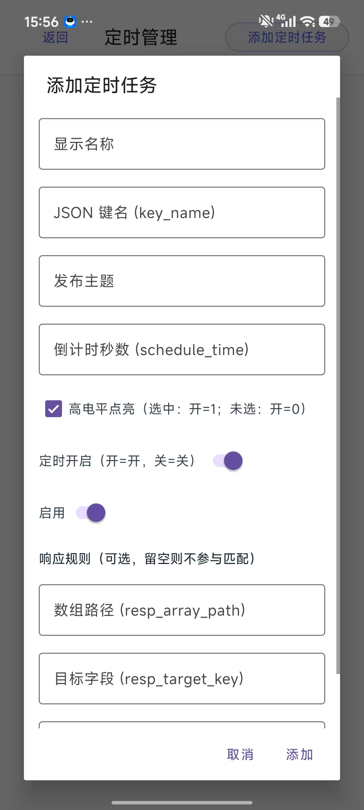 | 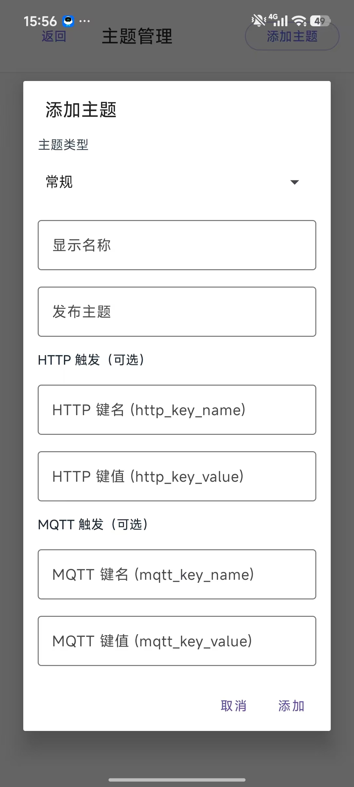 |
| 倒计时秒数后把指定键名置为目标状态并发布；含定时开启、启用开关与响应规则 | 五色主题类型 + 发布主题，支持 HTTP 与 MQTT 两种键名 / 键值触发方式 |

三个管理页的「响应规则」字段留空即不参与匹配，填写后上行数据会经
`ResponseRuleEngine` 的 `getByPath` 点路径取值（支持 `[n]`、`*`、`**`）并触发对应
动作。

---

## 五、设备端数据

用 MQTTX 以 `stm32/sensor` 主题发布同一份 JSON（QoS 0），可直接观察应用侧的解析
结果：

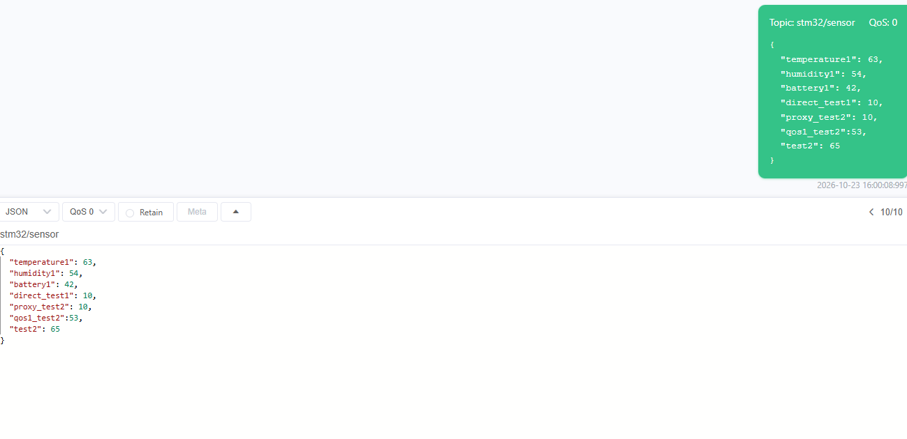

返回值与本页开头所列载荷一致，验证了「普通设备」按末尾数字拆分、去后缀显示的两步
逻辑。
